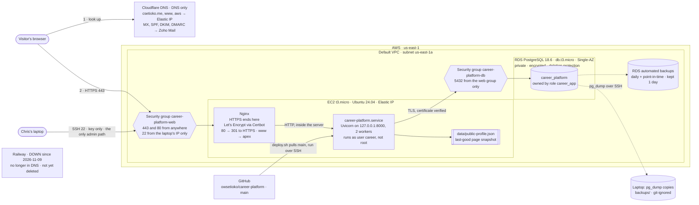

# Personal Resume Platform

A Codespaces-first personal resume site built with FastAPI, Jinja2,
SQLAlchemy and plain CSS. It uses SQLite locally and PostgreSQL in production,
where it runs on AWS (see [Deploy on AWS](#deploy-on-aws)). The public page can
use a saved profile snapshot if the database is temporarily unavailable. An optional password-protected admin area lets the
owner edit the profile and its experience, skills, projects, and education.

## Start in GitHub Codespaces

1. Open this repository in a Codespace and wait for the workspace to finish
   starting.
2. Open **Terminal → New Terminal**.
3. Create a Python virtual environment, install the dependencies, and create
   your local settings file:

   ```bash
   python --version
   python -m venv .venv
   source .venv/bin/activate
   python -m pip install -r requirements-dev.txt
   cp .env.example .env
   ```

   The app supports Python 3.10 or newer. Keep the virtual environment
   activated in each terminal where you run the app or tests.
4. Create the SQLite tables and starter profile:

   ```bash
   python -m app.database
   ```

   You can safely run this command again after an app update; it creates
   missing tables/columns and does not duplicate the starter profile. The
   default database is `data/resume.db`. The `data/` directory is ignored by
   Git, so your database and profile snapshot are not committed.
5. Start the development server:

   ```bash
   uvicorn app.main:app --reload --host 0.0.0.0 --port 8000
   ```

6. In Codespaces, open the **Ports** panel and follow the link for port 8000.
   The first page uses clearly marked starter-profile placeholders. Replace
   them in the admin area before sharing your site. Stop the server with
   **Ctrl+C** in the terminal.

To run outside Codespaces, use the same commands and open
`http://127.0.0.1:8000` in your browser. The environment file is named `.env`;
it is intentionally excluded from Git. `.env.example` documents the basic
settings:

```dotenv
APP_TITLE=Personal Resume Platform
DATABASE_URL=sqlite:///./data/resume.db
```

`DATABASE_URL` is a SQLAlchemy database URL. Leave the example value for the
default local SQLite file, or change it to another SQLite path if needed. This
app's deployment guidance below assumes SQLite on one VM; it is not a
multi-instance database setup.

## Configure the owner admin

Admin is disabled until both an Argon2id password hash and a session-signing
secret are configured. The public page still works when admin is disabled.
Do not put a plain-text password in `.env`, and never commit `.env` or copy
real secrets into this README.

1. In an activated virtual environment, create a password hash. The prompt
   does not echo the password:

   ```bash
   python -c 'from getpass import getpass; from argon2 import PasswordHasher; print(PasswordHasher().hash(getpass("Admin password: ")))'
   ```

2. Generate a separate random session secret:

   ```bash
   python -c 'import secrets; print(secrets.token_urlsafe(48))'
   ```

3. Open `.env` in the Codespaces editor or a terminal editor such as `nano .env`.
   Add both generated values:

   ```dotenv
   ADMIN_PASSWORD_HASH=paste-the-generated-argon2id-hash-here
   SESSION_SECRET=paste-the-generated-session-secret-here
   ```

   The session secret must be at least 32 bytes. Keep `.env` private and
   untracked; on a hosted machine use a root-readable deployment environment
   file or a secret manager instead.
4. Set the cookie option to match the URL you use:

   ```dotenv
   SESSION_COOKIE_SECURE=false
   ```

   Use `false` only for plain-HTTP local development. If you access the app
   over HTTPS—including an HTTPS Codespaces forwarded port—set it to `true`.
   Restart the server after changing `.env`.
5. Visit `/admin/login`, sign in, and use the dashboard to update the profile
   and manage content. Every admin page requires authentication. Forms include
   CSRF protection; cookies are HttpOnly and SameSite=Lax. Content items can
   be hidden or assigned a display order.

## Database, public page, and tests

The owner profile has the slug `owner` and is created by
`python -m app.database`. The public page reads the profile and visible
content from SQLite. It is served at `/`; the stylesheet is at
`/static/css/styles.css`.

After a successful database read, the app refreshes
`data/public-profile.json` as a last-known-good public snapshot. If a database
read fails, the page uses that snapshot, or the bundled starter profile if
there is no usable snapshot. The fallback keeps the public page readable; it
does not make admin edits available while the database is down. Protect and
back up both the database and snapshot in a deployment.

Run all tests from the repository root with the virtual environment active:

```bash
python -m pytest
```

Tests use isolated temporary databases and do not require real profile data or
admin credentials.

## Troubleshooting

- **`ModuleNotFoundError` or missing package:** activate `.venv` and run
  `python -m pip install -r requirements-dev.txt` again.
- **The page cannot find the database or profile:** stop the server, run
  `python -m app.database` from the repository root, then restart it. The
  initializer creates the parent directory for a configured SQLite file.
- **Port 8000 is already in use:** stop the other server, or choose another
  port in the `uvicorn` command and open that port in Codespaces.
- **`/admin` says admin is not configured:** check that `.env` contains both
  `ADMIN_PASSWORD_HASH` (a valid Argon2id hash) and a `SESSION_SECRET` of at
  least 32 bytes, then restart the app. Do not paste the plaintext password
  as the hash.
- **Admin login succeeds but pages keep returning to login:** clear the
  browser's `resume_session` cookie, confirm the app URL uses the expected
  HTTP/HTTPS setting for `SESSION_COOKIE_SECURE`, and sign in again.
- **The public page shows a temporary database warning:** verify that the
  configured database file exists and that the app's operating-system user
  can read and write its directory. The snapshot or bundled starter profile
  may still render while you restore database access.
- **Local changes are not showing:** confirm you edited the `owner` profile
  in `/admin`, saved the form, and left the content item visible. A hidden
  item is intentionally omitted from the public page.

## Deploy on AWS

Since 2026-11-09, `csetioko.me` runs on AWS in `us-east-1`: one EC2 server
for the app and a private RDS PostgreSQL database. It moved from Railway,
which stopped serving the site that day. The step-by-step plan is in
[docs/superpowers/plans/2026-11-04-aws-ec2-rds-migration.md](docs/superpowers/plans/2026-11-04-aws-ec2-rds-migration.md),
and every place the real run differed from it is in
[migration-notes.md](migration-notes.md).

### Architecture and why



- **EC2 + RDS** was the balance between three options compared before the move.
  EC2 with PostgreSQL on the same server was cheaper (about $10/month) but left
  backups, upgrades and recovery to me. Lambda with API Gateway was the least
  to operate, but needed code changes and has cold starts. EC2 + RDS needed no
  code changes and gets managed, encrypted database backups. The cost is about
  $28/month and one server to look after.
- **x86 `t3.micro`, not ARM:** the course IAM policy allows only `t3.micro`
  and `t3.small`.
- **Nginx + Certbot, not a load balancer:** AWS's own certificates (ACM)
  attach only to services like load balancers, which would add about
  $16–22/month. Certbot renews the Let's Encrypt certificates automatically.
- **Private database:** RDS has no public address, and only the web server's
  security group can reach port 5432. The app connects as `career_app`, a
  role that owns only this database, with `sslmode=verify-full` against
  AWS's certificate bundle.
- **SSH, not Session Manager:** the IAM policy denies Systems Manager, so
  administration is SSH with a key, limited to the laptop's IP.
- **Admin is off in production**, as it was on Railway. Turning it on needs
  login rate limiting first.

### Running and deploying

Everything on the server lives in `/opt/career-platform`, owned by the
`career` system user. The files in [`deploy/`](deploy/) are the service
definition, the Nginx site, the deploy script and a database fingerprint
query.

```bash
# Connect (from the laptop)
ssh -i ~/.ssh/isba4775_aws ubuntu@csetioko.me

# Deploy the latest main (on the server)
bash /opt/career-platform/deploy/deploy.sh

# Health and logs (on the server)
systemctl status career-platform nginx
sudo journalctl -u career-platform -n 50 --no-pager
```

`deploy.sh` pulls `main`, installs from `uv.lock`, runs `python -m app.database`,
restarts the service and fails unless the home page shows the real profile.
A `200` alone isn't enough, because the app serves its fallback page with a
`200` when the database is down.

If SSH times out, the laptop's IP has probably changed. Add the new one to
the web security group, and remove the old `/32` rule:

```bash
aws ec2 authorize-security-group-ingress --profile isba-4775 --group-id <web-sg-id> \
  --protocol tcp --port 22 --cidr $(curl -s https://checkip.amazonaws.com)/32
```

The server's `/opt/career-platform/.env` (mode 600, never committed) sets:

| Variable | Value |
| --- | --- |
| `DATABASE_URL` | `postgresql://career_app:…@<rds-endpoint>:5432/career_platform?sslmode=verify-full&sslrootcert=/etc/career-platform/rds-global-bundle.pem` |
| `APP_TITLE` | `Personal Resume Platform` |
| `GA_MEASUREMENT_ID` | `G-X0HGGMK1T8` |

`FORWARDED_ALLOW_IPS` is deliberately unset: the default `127.0.0.1` trusts
only the local Nginx. Railway's `*` would let visitors fake their IP address.

Certbot edited the live Nginx file on the server, so the repo copy in
`deploy/nginx-career-platform.conf` has no HTTPS lines. Copying it onto the
server again would turn HTTPS off until `sudo certbot --nginx` is rerun.

### Backups and restore

| Copy | Where | How long | Restore tested? |
| --- | --- | --- | --- |
| RDS automated backups | AWS, same account and region | 1 day (the free plan's maximum) | No |
| `pg_dump` files | Laptop, `backups/` (git-ignored) | Until deleted | Yes, twice |

- **From a dump** (tested): RDS has no public address, so copy the dump to
  the server with `scp`, then run `pg_restore --no-owner --no-acl
  --single-transaction --exit-on-error` there, into an empty database, before
  `deploy.sh` or `python -m app.database` touches it. `pg_restore` must be
  version 18 or newer. Then run `deploy/db-fingerprint.sql` against the source
  and the restored database, and `diff` the two outputs. Done on 2026-11-02
  (into a local Postgres 18) and 2026-11-09 (into RDS). Every table's row
  count and content checksum and every ID sequence matched.
- **From RDS backups** (not tested yet): `aws rds
  restore-db-instance-to-point-in-time` creates a new instance from any moment
  in the last day. Point `DATABASE_URL` at it and redeploy.
- **Taking a new dump:** on the server, `pg_dump "$DATABASE_URL"
  --format=custom --no-owner --no-acl`, then `scp` the file to the laptop's
  `backups/` and delete it from the server. Copies outside AWS matter: if the
  account closes, its RDS backups go with it.

### What was tested on `aws.csetioko.me`

Before `csetioko.me` moved, the AWS copy was tested at its own name, `aws.csetioko.me`
(details and evidence in [migration-notes.md](migration-notes.md)). All of these passed:

- The `aws` DNS record pointed at the Elastic IP, DNS only, and no other record
  changed (checked against a snapshot of all 10 records taken beforehand).
- `nslookup` answered with the Elastic IP from the laptop.
- HTTP redirected to HTTPS. The Let's Encrypt certificate verified over TLS 1.3,
  and `certbot renew --dry-run` succeeded.
- The home and privacy pages, CSS, JavaScript and fonts loaded. Admin returned
  `503` (off by design) and unknown paths `404`. 20 of 20 loads succeeded, at
  about 0.33 s each.
- All 26 visible database items appeared on the page, with no fallback or
  placeholder content.
- The app's database connection used TLS as `career_app`. Logs recorded real
  visitor IPs, as the privacy page says. Port 8000 and the database weren't
  reachable from outside, and everything came back after a reboot.

After the cutover, the same checks passed on `csetioko.me` and `www`, and the
mail DNS records were identical to before.

**Not tested yet:** the page when RDS is unreachable, restoring from RDS's own
backups, a real (not dry-run) certificate renewal, phones and other
browsers, and heavier traffic. IPv6 doesn't work: the server has no IPv6
address and there is no AAAA record.

### Next steps

- [ ] As root: check the AWS credit balance and expiry, add a zero-spend
      budget (the course guide's choice; it emails on the first charge not
      covered by credits), and confirm MFA on root. Stay on the free plan for
      the course; decide at semester's end whether to keep paying, move to a
      cheaper host, or delete the AWS resources.
- [ ] Send an email round-trip to `chris@csetioko.me` to confirm mail after
      the DNS change.
- [ ] Test the fallback page with RDS unreachable, and a point-in-time restore.
- [ ] Add a free uptime monitor; nothing alerts on an outage today.
- [ ] Add login rate limiting before turning admin on.
- [ ] Delete the Railway project and the leftover Azure resource group, which
      still bills for its disk and IP.
- [ ] Add a passphrase to the SSH key, and narrow `isba-student`'s permissions
      now that the build is done.

### Earlier hosting

Production ran on Railway (web service + PostgreSQL) from 2026-10-08 to
2026-11-09, and on an Azure VM with SQLite before that. `railway.json` and
`app/copy_database.py` remain from the Railway move. `copy_database` loads a
local SQLite file into an empty Postgres database:

    uv run python -m app.copy_database data/resume.db

To run the Postgres integration tests, point `TEST_DATABASE_URL` at a local
database (for example `postgresql://localhost/career_platform_test`). The
tests refuse any host other than localhost because they drop tables.

## Costs

What running this project has cost so far, checked 2026-10-22, plus the AWS
estimate added 2026-11-09. No card has been charged; everything is covered by
student credit, a trial grant, or a free plan.

| Service | What it's for | Plan | Cost so far |
| --- | --- | --- | --- |
| Azure | The original VM (`rg-career-platform`), now deallocated | Azure for Students credit | ≈ $4.70 (Sep 1 to Oct 21): $3.53 static public IP, $1.16 disk, $0.00 VM compute, ~$0 bandwidth |
| AWS | Production since 2026-11-09: EC2, RDS, Elastic IP | Free plan with starting credits | Estimated **$27.96/month** on-demand (see below); actual charges not yet checked |
| Railway | Production web service and PostgreSQL until 2026-11-09 (now down) | Trial: one-time $5.00 credit, 1 GB RAM, 2 vCPU, 1 GB disk | $0.54 usage (Oct 8 to 22), [screenshot](docs/evidence/railway-usage.png) |
| Namecheap | The `csetioko.me` domain | GitHub Student Pack | $0 |
| Zoho Mail | `chris@csetioko.me` mailbox | GitHub Student Pack | $0 |

The Azure figure comes from a Cost Management query scoped to the resource
group. The VM size had no compute charge, but the disk and the reserved
public IP keep billing while the VM is deallocated. Deleting the resource
group (`az group delete -n rg-career-platform`) stops those charges and
removes the rollback path.

The AWS estimate uses AWS's public us-east-1 price lists (published
2026-10-29 to 2026-11-04) for 730 hours a month:

| AWS item | Rate | Per month |
| --- | --- | --- |
| EC2 `t3.micro` | $0.0104/hour | $7.59 |
| EC2 disk, 16 GB gp3 | $0.08/GB-month | $1.28 |
| Public IPv4 (Elastic IP) | $0.005/hour | $3.65 |
| RDS `db.t3.micro`, Single-AZ, PostgreSQL | $0.018/hour | $13.14 |
| RDS storage, 20 GB gp3 | $0.115/GB-month | $2.30 |
| RDS backups | free up to 20 GB, the size of the provisioned storage | $0.00 |
| Data transfer out | first 100 GB/month free | $0.00 |
| **Total** | | **$27.96** |

On the AWS free plan, the account closes when the plan period ends or its
credits run out, and is deleted 90 days later unless it's upgraded. At this
rate, $100 of credit lasts about 3.6 months. Stopping the server doesn't stop
the IP, disk and database charges; only deleting them does.

Railway's trial credit is a one-time grant. When it runs out or the trial
ends, the site needs the Hobby plan (paid monthly) to stay up. Railway
stopped serving the site on 2026-11-09. The domain
and the Zoho offer also run out when the Student Pack benefit ends, so check
both renewal dates.

## Reflection

The biggest surprise was that the deployment failed before my code even ran. Railway’s build stopped at “Railpack failed to prepare the build,” and I had to dig into the deployment details to see why.

On the Azure VM I did the server work myself just like opening SSH and the web ports in the network security group, running Nginx etc. Railway handles the build, running the app, and HTTPS for me, so I just connect the repo and add my domain.

The checks that actually proved things were dig to see where the domain’s DNS really pointed, and curl -Iv to see which certificate the site was serving.

I would definitely start with Railway as it is much simpler and easier and I would also check the DNS records before moving so that the old VM doesn't keep receiving traffic.

## Future Azure Linux VM readiness (guidance only)

These notes describe a possible later single-VM setup; they do not create Azure
resources or deploy the app. Plan to use a supported Linux VM, install a
maintained Python 3.10+ runtime, and install the version-constrained project
requirements into a virtual environment. Keep the deployment code separate from the
persistent data disk, and test upgrades and restores before relying on the
site.

### Persistent files and secrets

- Put `resume.db` and `public-profile.json` on persistent, backed-up storage.
  The app expects the snapshot at `<app-directory>/data/public-profile.json`;
  a simple layout is a separately mounted Azure managed data disk mounted at
  `<app-directory>/data`. Mount it by a stable disk identifier in the VM's
  boot-time mount configuration, not by an unstable device name. Confirm the
  disk is mounted before starting the app, and set directory ownership and
  permissions so only the service account can write there. Do not keep the
  only copy on an OS temporary/ephemeral disk.
- Alternatively, set `DATABASE_URL` to a SQLite file on persistent storage.
  The profile snapshot still lives in the app's `data/` directory, so protect
  that directory too. For example, an absolute SQLite path such as
  `/var/lib/personal-resume-platform/resume.db` is written as
  `sqlite:////var/lib/personal-resume-platform/resume.db`.
- This SQLite design is for one VM and one app worker, not multiple app
  instances sharing a database file. Keep a stable app path or explicitly
  move both persistent data paths before upgrading the code.
- Set `ADMIN_PASSWORD_HASH`, `SESSION_SECRET`, `DATABASE_URL`, and
  `SESSION_COOKIE_SECURE=true` in the service environment. Generate a unique,
  random session secret and a strong admin password hash for the deployment;
  never reuse development values or commit any secrets. Store secrets in an
  appropriately protected secret manager or a root-owned environment file
  (for example, mode `600`); do not put them in shell history or a
  world-readable file. Restrict access to backups because they contain the
  public profile and database.

### Service startup and recovery

Run Uvicorn under a dedicated, non-login service account and a process
supervisor such as `systemd`, rather than leaving it in an interactive SSH
terminal. A unit should use the app directory as its working directory, load
the protected environment file, bind Uvicorn to `127.0.0.1:8000`, and restart
on failure. For example, after creating the service account, app directory,
virtual environment, and protected environment file, a unit at
`/etc/systemd/system/personal-resume-platform.service` could contain:

```ini
[Unit]
Description=Personal Resume Platform
After=network.target

[Service]
User=personal-resume-platform
Group=personal-resume-platform
WorkingDirectory=/opt/personal-resume-platform
EnvironmentFile=/etc/personal-resume-platform.env
ExecStart=/opt/personal-resume-platform/.venv/bin/uvicorn app.main:app --host 127.0.0.1 --port 8000
Restart=on-failure
RestartSec=5
UMask=0077

[Install]
WantedBy=multi-user.target
```

Adjust the paths and account to match the VM, and make sure that account can
read the app and write to the persistent data directory. A typical operator
workflow after creating and reviewing the unit is:

```bash
sudo systemctl daemon-reload
sudo systemctl enable --now personal-resume-platform
sudo systemctl status personal-resume-platform
sudo journalctl -u personal-resume-platform
```

Initialize or upgrade the schema deliberately with the deployment's virtual
environment before bringing the service back up:
`<app-directory>/.venv/bin/python -m app.database`. Check the service logs and
the public page after a restart. To restart after changing app code or
environment settings, run
`sudo systemctl restart personal-resume-platform`; after editing the unit,
run `sudo systemctl daemon-reload` first. Ensure the persistent disk is
mounted and writable before running initialization or starting the service.

### HTTPS, proxy, and network

Put a maintained reverse proxy such as Nginx or Caddy in front of Uvicorn and
configure HTTPS with a valid certificate. Configure the proxy to pass the
original host and HTTPS scheme, and configure Uvicorn to trust forwarded
headers only from that local proxy. Do not make port 8000 publicly reachable.
With HTTPS enabled, `SESSION_COOKIE_SECURE=true`; this keeps the admin session
cookie restricted to secure connections.

At the Azure network security group and VM firewall, allow inbound HTTPS
(TCP 443) for visitors, and allow HTTP (TCP 80) only if it is needed to
redirect to HTTPS or complete certificate renewal. Restrict SSH (TCP 22) to
trusted administrator addresses or an approved management path; use
key-based access. Do not expose the SQLite file or database ports to the
internet. Keep OS packages, Python dependencies, and the proxy updated.

### Backups and restore

Back up the SQLite database and profile snapshot on a schedule to storage
separate from the VM/data disk, with encryption, access controls, and a
retention policy. Use SQLite's supported online backup mechanism or stop the
service for a consistent file copy; copying only a live `.db` file can miss
uncheckpointed journal/WAL data. Include the snapshot in the same backup
plan, and consider Azure managed-disk backup/snapshots as an additional
recovery layer rather than the only off-machine backup. Periodically test
restoring both files to a separate location and verify the app and profile
before depending on the backups.
