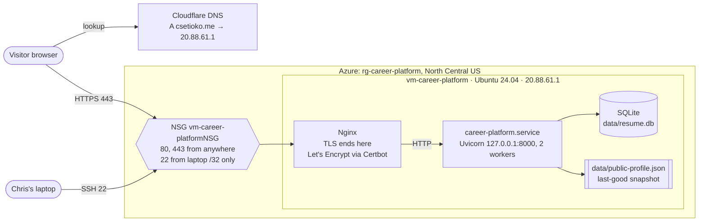
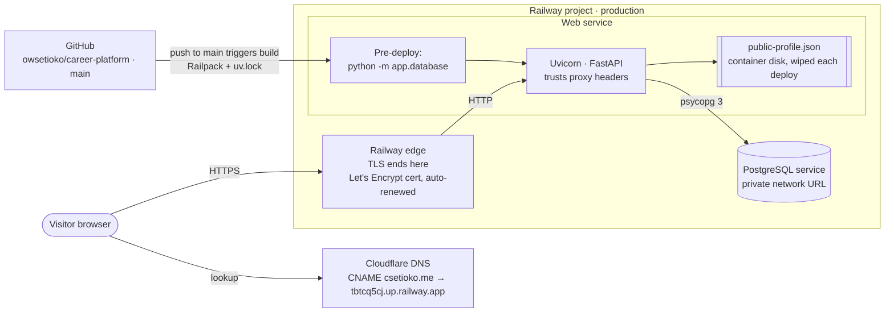

# Architecture

How `csetioko.me` was served from the Azure VM, how it is served from
Railway now, and where email and analytics data go. Drawn from the plans
and evidence in this repo; GitHub renders the diagrams.

## Before: Azure VM (2026-10-07 to 2026-10-08)

Sources: [Azure VM migration plan](superpowers/plans/2026-09-24-azure-vm-migration.md),
[operate the VM plan](superpowers/plans/2026-10-01-operate-the-vm.md),
[How this site is secured](how-this-site-is-secured.md).



## Now: Railway + PostgreSQL (since 2026-10-08)

Sources: [Railway migration plan](superpowers/plans/2026-10-08-railway-postgres-migration.md),
[`railway.json`](../railway.json), README → *Deploy on Railway*.



The Azure VM was left running untouched as the rollback path (see
[project-1-submission.md](project-1-submission.md#4-migration-cutover-and-rollback)).

## Email: Zoho Mail on `csetioko.me`

Sources: [Ex06](evidence/ex06.md), [Zoho header check](evidence/zoho-header-check.md),
[DNS before Zoho](evidence/dns-before-zoho.md).

```mermaid
flowchart LR
    ext([Outside mailbox<br/>e.g. Gmail])
    dns[Cloudflare DNS<br/>MX mx/mx2/mx3.zoho.com<br/>SPF include:zohomail.com<br/>DKIM zmail._domainkey<br/>DMARC p=none]
    zoho[Zoho Mail<br/>chris@csetioko.me]

    ext -- 1. look up MX --> dns
    ext -- 2. deliver inbound --> zoho
    zoho -- 3. send / reply, DKIM-signed<br/>from sender*.zoho.com, TLS --> ext
    ext -. 4. check SPF, DKIM, DMARC .-> dns
```

Email never touches the web app, Railway, or Azure. Only DNS is shared.

## Analytics: Google Analytics 4 (opt-in)

Sources: [`app/static/js/consent.js`](../app/static/js/consent.js),
[`app/templates/_consent.html`](../app/templates/_consent.html), the
[privacy page](https://csetioko.me/privacy), [Ex06](evidence/ex06.md#3-google-analytics).

```mermaid
sequenceDiagram
    participant B as Visitor browser
    participant S as csetioko.me (Railway)
    participant G as Google (gtag.js / GA4)
    B->>S: GET /
    S-->>B: page + consent banner + consent.js
    Note over B: Nothing is sent to Google yet
    alt Visitor clicks Accept
        B->>B: store choice in localStorage
        B->>G: load gtag.js (measurement ID G-X0HGGMK1T8)
        B->>G: page_view
        B->>G: click on outbound link (link_domain, link_url, outbound)
    else Visitor clicks Decline
        B->>B: store choice; gtag.js never requested
    end
```
