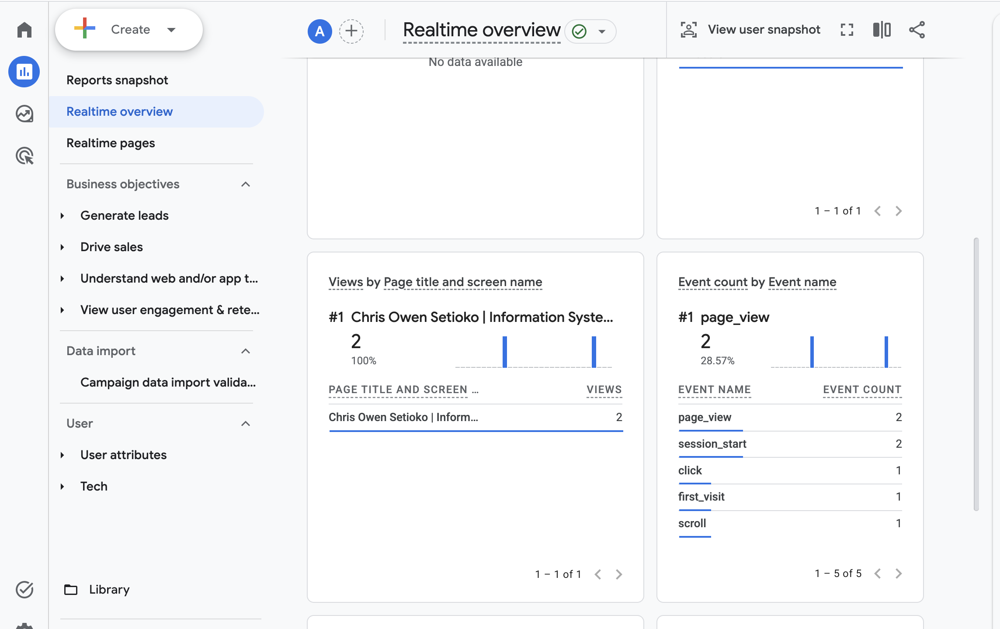
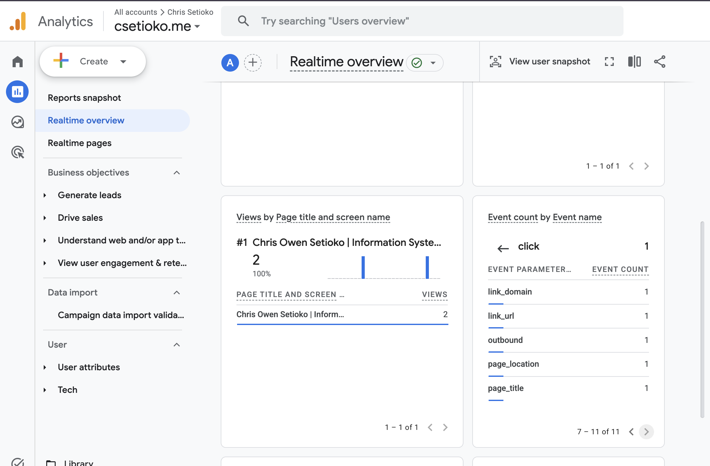

# Ex06: Domain email and Google Analytics

Results for the Zoho Mail mailbox on `csetioko.me` and Google Analytics 4 on
the live site. Times are Pacific. Message bodies and the outside mailbox's
address are left out; it is described only as "a Gmail inbox".

## 1. Email tests

Tests run on 2026-10-13 in Zoho webmail.

| Test | Time | Result |
| ---- | ---- | ------ |
| Received (Gmail → Zoho) | Sent from Gmail 2:58:28 PM; shown in Zoho at 2:58 PM | Arrived in the Zoho Inbox, subject "Test:02 outbound". |
| Replied (Zoho → Gmail, in thread) | Sent 3:10 PM; Gmail shows it at 3:10 PM | Zoho shows "Re: Test:02 outbound" as Sent. It arrived in the Gmail inbox, threaded under the original "Test:02 outbound" message from 2:58 PM. |
| Sent a new message (Zoho → Gmail) | Sent 3:10:53 PM; Gmail received it 3:10:57 PM | Delivered to the Gmail inbox, subject "Test:02 real outbound", From `chris@csetioko.me`, relayed by `sender6-of-o52.zoho.com` over TLS 1.3. |

The authentication results for the received message (Zoho's "Show
Original") were not captured.

## 2. Authentication results

From Gmail's "Show original" for the new outgoing message, "Test:02 real
outbound". The mailbox name and DKIM signature hash are removed.

```
Authentication-Results: mx.google.com;
       dkim=pass header.i=@csetioko.me header.s=zmail;
       spf=pass smtp.mailfrom=csetioko.me;
       dmarc=pass (p=NONE sp=NONE dis=NONE) header.from=csetioko.me
```

SPF, DKIM and DMARC all pass and align to `csetioko.me`. The fuller header
check is in [zoho-header-check.md](zoho-header-check.md).

## 3. Google Analytics

- Live site: https://csetioko.me/
- Privacy page: https://csetioko.me/privacy

GA4 loads only after a visitor chooses Accept in the site's cookie banner,
so the checks below were done in my own browser after accepting.

`page_view` and `click` in Realtime, Event count by Event name:



The `click` from the site's GitHub link, opened to show that it carries
`link_domain`, `link_url` and `outbound` parameters:


