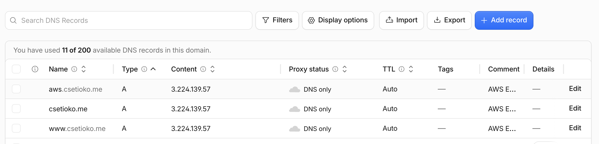
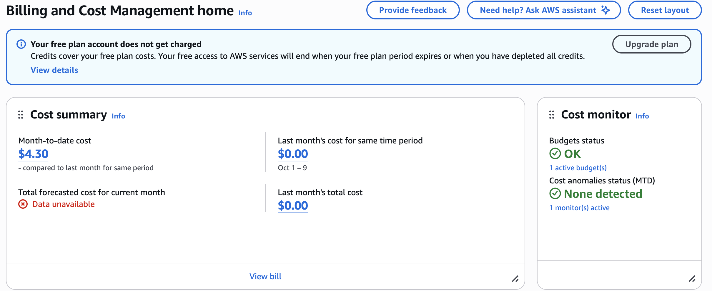

# Ex07: Migrate from Railway to AWS

Results for moving `csetioko.me` from Railway to AWS (EC2 + RDS). Times are
Pacific. The architecture diagram is in the README:
[Deploy on AWS → Architecture and why](../../README.md#architecture-and-why).
Every place the move differed from the plan is in
[migration-notes.md](../../migration-notes.md).

## 1. Architecture decision

I chose EC2 with a Single-AZ RDS PostgreSQL database over EC2 with PostgreSQL
on the same server (and over Lambda with API Gateway) because I wanted managed,
encrypted database backups without changing my app's code, and I accept paying
about $28 a month instead of about $10 and still patching one server myself.

## 2. Backup record

| | |
| --- | --- |
| Backup | 2026-11-02, 9:14 PM: `pg_dump` (custom format) of the Railway PostgreSQL 18.6 database, with a SHA-256 checksum. Kept on my laptop, outside the repo and outside AWS. |
| Restore test 1 | 2026-11-02, into a new local PostgreSQL 18 database without touching Railway. All 8 tables' row counts and content checksums and all 6 ID sequences matched Railway. The app, pointed at the copy, showed my real profile. **Pass.** |
| Restore test 2 | 2026-11-09, the same file into the empty RDS database, from the EC2 server. Fingerprint identical to the backup. **Pass.** |
| Ongoing backups | RDS automated backups, daily plus point-in-time, kept 1 day (the free plan's limit). New `pg_dump` copies are taken over SSH to the laptop. |
| Data loss I accept (RPO) | Up to 24 hours. Point-in-time restore covers the last day, and the content changes rarely because admin editing is off. |
| Recovery time I accept (RTO) | Up to 4 hours: restoring a dump from the EC2 server took one command, and rebuilding the server from the plan takes longer. |

## 3. Verification on the test subdomain

Tested at `aws.csetioko.me` on 2026-11-09, before the real domain moved.

| Test | Evidence | Result |
| --- | --- | --- |
| DNS record `aws` → Elastic IP, DNS only, nothing else changed | Cloudflare CLI listing: one A record, `proxied: false`; the other 10 records identical to a snapshot taken before the change | Pass |
| `nslookup aws.csetioko.me` | Answered with the Elastic IP from my laptop's resolver | Pass |
| HTTPS certificate | Let's Encrypt certificate for `aws.csetioko.me`, verified by `openssl` over TLS 1.3, valid until 2027-02-08 | Pass |
| HTTP redirects to HTTPS | `http://aws.csetioko.me/privacy` → `301` → `https://aws.csetioko.me/privacy` | Pass |
| Certificate renewal | `certbot renew --dry-run`: "all simulated renewals succeeded"; `certbot.timer` active | Pass |
| Pages and files load | Home and privacy `200`; CSS, JavaScript and fonts `200`; admin `503` (off by design); unknown path `404` | Pass |
| Real data, not the fallback | All 26 visible database items on the page; no fallback warning or placeholder profile | Pass |
| Database connection is private and encrypted | App connects as `career_app` with TLS; database and app port unreachable from the internet | Pass |
| Response time | 20 of 20 loads `200`, about 0.33 s each | Pass |
| Survives a reboot | Server rebooted; site returned on the same IP with no manual steps | Pass |
| Padlock in a browser | Checked by me on 2026-11-09: secure-connection icon with no warning; certificate issued to `aws.csetioko.me` by Let's Encrypt, valid until 8 February 2027 | Pass |
| Page when RDS is unreachable | Not run | Not verified |
| Restore from RDS's own backups | Not run | Not verified |

## 4. Cutover status

Done. `csetioko.me` and `www.csetioko.me` moved to AWS on **2026-11-09 at
9:20 PM**, through the Cloudflare CLI. Railway had already stopped serving the
site (every page returned `404 Application not found`), so there was no
working copy to fall back to. After the switch, the site loaded over HTTPS with
a new Let's Encrypt certificate, `www` and HTTP redirected to
`https://csetioko.me`, and the mail records were unchanged.

## 5. Cost

| | |
| --- | --- |
| Estimate (section 6) | **$27.96 a month**: RDS `db.t3.micro` $13.14, EC2 `t3.micro` $7.59, public IPv4 $3.65, RDS storage $2.30, EC2 disk $1.28. Backups and data transfer are $0 within their free allowances. From AWS's us-east-1 price lists, not memory. |
| Billing page now (2026-11-09) | Credits: **$140.00** total, **$4.30** estimated used, **$135.70** estimated remaining; $0.00 billed to a card. The $4.30 matches the estimate: it's about 4.6 days at $27.96 a month, and the resources have run for about 5 days. At this rate the credits last about 4.9 more months. AWS updates these estimates about every 24 hours. |

